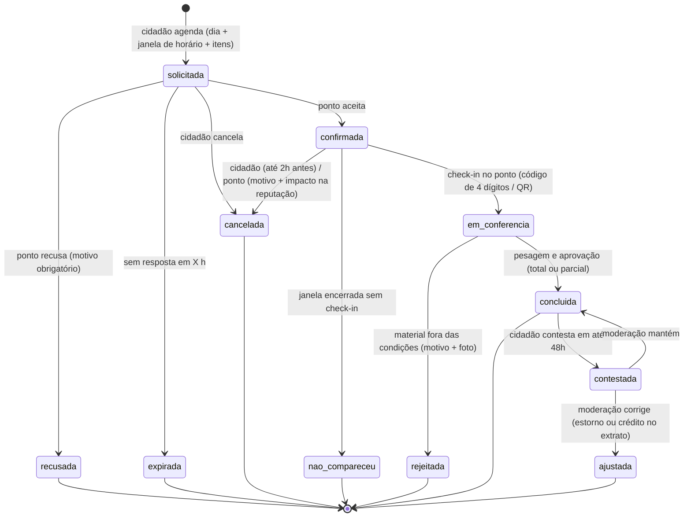
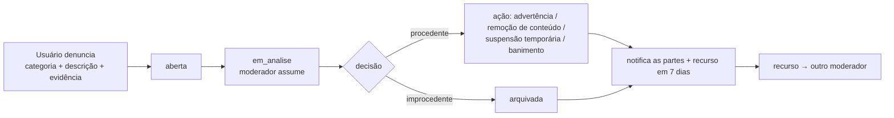
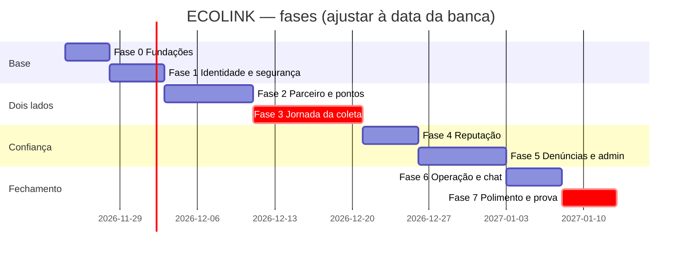

# 🗺️ ECOLINK — Roadmap da jornada completa (Cliente ⇄ Reciclador ⇄ Plataforma)

> **Objetivo:** levar o ECOLINK de um app só do cliente para uma **plataforma de dois lados**, no estilo de um marketplace de delivery. Ela precisa cobrir a jornada **de ponta a ponta**: quem descarta, quem recebe e quem modera. O desenho precisa deixar claro para a banca que **experiência** e **segurança** foram pensadas com cuidado nos dois lados.
>
> **Restrição assumida:** ainda não existe banco de dados real. Tudo continua salvo **no dispositivo**, mas a arquitetura é desenhada para trocar o armazenamento por uma API **sem reescrever as telas**.

---

## Sumário

0. [Diagnóstico do estado atual](#0-diagnóstico-do-estado-atual)
1. [Visão, analogia e princípios](#1-visão-analogia-e-princípios)
2. [Papéis e permissões](#2-papéis-e-permissões-rbac)
3. [A jornada central: ciclo de vida da coleta](#3-a-jornada-central-ciclo-de-vida-da-coleta)
4. [Área do Reciclador (parceiro)](#4-área-do-reciclador-parceiro)
5. [Evolução da Área do Cliente](#5-evolução-da-área-do-cliente)
6. [Confiabilidade e reputação](#6-confiabilidade-e-reputação)
7. [Denúncias, moderação e sanções](#7-denúncias-moderação-e-sanções)
8. [Área Administrativa](#8-área-administrativa-moderação)
9. [Segurança e privacidade (LGPD)](#9-segurança-e-privacidade-lgpd)
10. [Arquitetura e modelo de dados (no dispositivo)](#10-arquitetura-e-modelo-de-dados-no-dispositivo)
11. [Experiência (UX) transversal](#11-experiência-ux-transversal)
12. [Qualidade e engenharia](#12-qualidade-e-engenharia)
13. [Fases de entrega](#13-fases-de-entrega)
14. [Roteiro de demonstração para a banca](#14-roteiro-de-demonstração-para-a-banca)
15. [Riscos e mitigação](#15-riscos-e-mitigação)
16. [Decisões em aberto](#16-decisões-em-aberto)
17. [Caminho para o Supabase](#17-caminho-para-o-supabase)

---

## 0. Diagnóstico do estado atual

**O que já existe e funciona bem:** mapa com busca e geolocalização, agendamento, gamificação (EcoPontos, níveis, conquistas, impacto), loja com voucher, avaliações, modo educação com quiz, chat simulado, notificações, ranking, PWA instalável e uma camada de "banco" (`src/store/db.js`) que já imita uma API.

**Lacunas que o roadmap resolve.** São problemas reais encontrados no código, e citá-los na apresentação mostra senso crítico:

| #   | Problema                                                                                         | Onde                                                  | Por que importa                                                                                                 |
| --- | ------------------------------------------------------------------------------------------------ | ----------------------------------------------------- | --------------------------------------------------------------------------------------------------------------- |
| D1  | **O próprio cliente marca a coleta como "concluída"** e ganha EcoPontos                          | `src/pages/MyCollections.jsx:26` → `coletas.concluir` | Fraude trivial: o sistema de recompensas não tem lastro. **É o motivo nº 1 para existir a área do reciclador.** |
| D2  | O peso é **declarado** pelo cliente e nunca conferido                                            | `ScheduleCollection.jsx`                              | Sem pesagem real, os EcoPontos e o impacto ambiental são fictícios                                              |
| D3  | Não há **papéis** (cliente / reciclador / admin)                                                 | `AuthContext.jsx`, `ProtectedRoute.jsx`               | Qualquer um pode fazer qualquer coisa                                                                           |
| D4  | **Senhas em texto puro** no `localStorage`                                                       | `db.js` → `usuarios.create`                           | Qualquer pessoa com acesso ao navegador lê as senhas                                                            |
| D5  | Sessão = só o id do usuário salvo; não expira                                                    | `AuthContext.jsx`                                     | Basta editar o id no DevTools para "virar" outra pessoa                                                         |
| D6  | **Regras de negócio só na interface** (ex.: saldo da loja validado só no componente)             | `Rewards.jsx:30`, `db.js` → `resgates.create`         | Em um backend real, a regra tem que estar no servidor. Aqui, na camada de dados                                 |
| D7  | Qualquer pessoa avalia qualquer ponto, **sem ter ido lá** — ✅ resolvido na Fase 4               | `PointDetail.jsx`                                     | Avaliações manipuláveis; nenhuma confiança                                                                      |
| D8  | Não existe denúncia, bloqueio nem moderação — ✅ resolvido na Fase 5                             | —                                                     | Requisito explícito do projeto                                                                                  |
| D9  | O chat é uma resposta automática por palavra-chave — ✅ resolvido na Fase 6                      | `db.js` → `respostaAutomatica`                        | Com o lado do reciclador, vira conversa real entre os dois lados                                                |
| D10 | Horário do ponto é texto livre (`"Seg-Sex 8h-18h"`)                                              | `seed.js`                                             | Impede agenda por horário, capacidade e "aberto agora"                                                          |
| D11 | Dependência `"reciclaja-api": "file:../reciclaja-api"` aponta para uma pasta fora do repositório | `package.json`                                        | **`npm install` quebra em um clone limpo** (e pode quebrar o deploy). Não é usada em `src/`                     |
| D12 | Seed com **datas fixas** (jun/2026)                                                              | `seed.js`                                             | Na apresentação, tudo aparece "atrasado" ou "antigo"; as datas precisam ser relativas a hoje                    |
| D13 | "Restaurar dados de demonstração" disponível para qualquer usuário no Perfil                     | `Profile.jsx`                                         | Deve ir para um painel de demonstração/admin                                                                    |
| D14 | Mudança de dados não sincroniza **entre abas**                                                   | `useDbVersion.js` só escuta o evento local            | Impede mostrar o cliente e o reciclador **lado a lado em duas abas**                                            |

---

## 1. Visão, analogia e princípios

### 1.1 A analogia com um marketplace de delivery

| Marketplace de delivery                     | ECOLINK                                                                             |
| ------------------------------------------- | ----------------------------------------------------------------------------------- |
| Cliente faz um **pedido**                   | Cidadão faz uma **solicitação de entrega de recicláveis**                           |
| **Restaurante** aceita, prepara e entrega   | **Ponto de coleta (reciclador)** aceita, recebe, **pesa e confere**                 |
| Acompanhamento do pedido em tempo real      | **Linha do tempo da coleta** (solicitada → confirmada → em conferência → concluída) |
| **Código de entrega** que o cliente informa | **Código de entrega de 4 dígitos / QR** que o cliente mostra no ponto               |
| Gestor de pedidos do restaurante            | **Painel de recebimentos** do reciclador                                            |
| Avaliação mútua, suporte, denúncias         | **Reputação bilateral**, denúncias e moderação                                      |
| Entregador                                  | _(fase opcional)_ **Coletor** que retira em domicílio                               |
| Pagamento                                   | **EcoPontos** creditados só após a **pesagem oficial**                              |

### 1.2 Princípios de design (para repetir na banca)

1. **Confiança se ganha nos dois lados.** O cliente avalia o ponto e o ponto avalia o cliente; cada um tem reputação.
2. **Quem recebe o material é quem confirma.** EcoPontos só existem depois que o **ponto pesa e aprova** o material.
3. **Mínimo de dados, máximo de controle.** Cada lado vê só o necessário, só quando necessário. O telefone e o nome completo do cliente não aparecem para o ponto.
4. **Toda ação sensível deixa rastro.** Há um log de auditoria imutável, e os EcoPontos ficam num extrato contábil (_ledger_) em vez de um número solto.
5. **Transparência das regras.** O usuário vê _por que_ tem determinada reputação e _como_ melhorar. As punições são explicadas e podem ser contestadas.
6. **Pronto para o backend.** As telas falam com repositórios assíncronos. Trocar o `localStorage` por uma API muda um arquivo, não o app.

---

## 2. Papéis e permissões (RBAC)

| Papel               | Quem é                                                              | Entra por                                     |
| ------------------- | ------------------------------------------------------------------- | --------------------------------------------- |
| `cidadao`           | Pessoa que descarta recicláveis                                     | Cadastro aberto                               |
| `parceiro_gestor`   | Responsável legal pela organização (cooperativa, ecoponto, empresa) | Cadastro de parceiro → **aprovação do admin** |
| `parceiro_operador` | Funcionário do ponto (atendente, balança)                           | **Convite** do gestor                         |
| `moderador`         | Equipe da plataforma que trata denúncias                            | Atribuído pelo admin                          |
| `admin`             | Administrador da plataforma                                         | Seed                                          |

Um mesmo usuário pode ter mais de um papel (ex.: operador que também recicla como cidadão), com um **seletor de perfil ativo** no topo, como um app que alterna entre conta pessoal e conta da loja.

### 2.1 Matriz de permissões (resumo)

| Ação                                          | cidadão | operador |     gestor     | moderador | admin |
| --------------------------------------------- | :-----: | :------: | :------------: | :-------: | :---: |
| Buscar pontos / agendar                       |   ✅    |   ✅\*   |      ✅\*      |     —     |   —   |
| Cancelar a própria solicitação                |   ✅    |    —     |       —        |     —     |   —   |
| Aceitar/recusar solicitações do **seu** ponto |    —    |    ✅    |       ✅       |     —     |   —   |
| Registrar check-in e **pesagem**              |    —    |    ✅    |       ✅       |     —     |   —   |
| Cadastrar/editar **ponto**                    |    —    |    —     |       ✅       |     —     |  ✅   |
| Convidar/remover operadores                   |    —    |    —     |       ✅       |     —     |  ✅   |
| Pausar recebimento ("fechar loja")            |    —    |    ✅    |       ✅       |     —     |  ✅   |
| Avaliar a outra parte após a coleta           |   ✅    |    ✅    |       ✅       |     —     |   —   |
| Denunciar                                     |   ✅    |    ✅    |       ✅       |     —     |   —   |
| Tratar denúncias / aplicar sanções            |    —    |    —     |       —        |    ✅     |  ✅   |
| Aprovar parceiros e pontos                    |    —    |    —     |       —        |     —     |  ✅   |
| Ver log de auditoria                          |    —    |    —     | o do seu ponto |    ✅     |  ✅   |

\* Com o perfil **cidadão** ativo, e **nunca no próprio ponto** (conflito de interesse; ver §9.4).

**Regra de ouro de implementação:** a permissão é checada **na camada de dados** (`domain/permissions.js`, chamada dentro de cada repositório), além de esconder botões na interface. Esconder o botão é UX; checar no repositório é segurança.

---

## 3. A jornada central: ciclo de vida da coleta

Este é o **coração do projeto**: uma máquina de estados explícita, testada e auditada.



### 3.1 Tabela de transições (quem pode o quê)

| De → Para                       | Ator            | Pré-condições                                                                                              | Efeitos colaterais                                                      |
| ------------------------------- | --------------- | ---------------------------------------------------------------------------------------------------------- | ----------------------------------------------------------------------- |
| — → `solicitada`                | cidadão         | ponto `ativo`, aceita o material, há vaga na janela, usuário sem bloqueio, dentro dos limites da reputação | notifica o ponto; reserva a vaga                                        |
| `solicitada` → `confirmada`     | operador/gestor | ponto ativo, vaga ainda livre                                                                              | gera o **código de entrega**; notifica o cidadão                        |
| `solicitada` → `recusada`       | operador/gestor | motivo da lista (lotado, material não aceito, fora do horário…)                                            | libera a vaga; notifica com sugestão de pontos próximos                 |
| `solicitada` → `expirada`       | sistema         | X horas sem resposta                                                                                       | conta contra a "taxa de resposta" do ponto                              |
| `*` → `cancelada`               | cidadão / ponto | regras da política de cancelamento                                                                         | cancelamento tardio afeta a reputação de quem cancelou                  |
| `confirmada` → `em_conferencia` | operador        | **código correto**, no dia, dentro da janela ± tolerância                                                  | registra hora de chegada                                                |
| `confirmada` → `nao_compareceu` | sistema         | janela + tolerância expirada                                                                               | afeta a reputação do cidadão                                            |
| `em_conferencia` → `concluida`  | operador        | peso aferido por item; condição do material                                                                | **lança crédito no extrato**; emite comprovante; libera avaliação mútua |
| `em_conferencia` → `rejeitada`  | operador        | motivo + foto (opcional)                                                                                   | sem pontos; o cidadão pode contestar                                    |
| `concluida` → `contestada`      | cidadão         | até 48h                                                                                                    | abre caso para a moderação                                              |
| `contestada` → `ajustada`       | moderador       | decisão fundamentada                                                                                       | lançamento de ajuste no extrato (nunca apaga o original)                |

> Toda transição gera um **evento** (`coleta_eventos`), que é a linha do tempo mostrada ao cliente e ao ponto. Também gera um registro no **log de auditoria**.

### 3.2 Entrega avulsa (sem agendamento)

Como no balcão de uma loja: o cidadão chega sem agendar. O operador escaneia o **QR do perfil** do cidadão (ou digita o código pessoal dele, de 6 caracteres) e registra a entrega já em `em_conferencia`. Os EcoPontos são creditados da mesma forma. Isso mostra que o app cobre o mundo real, não só o "caminho feliz".

### 3.3 Itens múltiplos

Uma coleta tem **N itens** (`material`, `kg_declarado`, `kg_aferido`, `status_item`). O ponto pode **aprovar parcialmente**: aceita o papel e rejeita o vidro quebrado, com motivo. Os pontos são calculados **sobre o peso aferido dos itens aprovados**.

---

## 4. Área do Reciclador (parceiro)

Rotas sob `/parceiro/*`, com layout e navegação próprios e cor de destaque diferente, para que nunca haja dúvida de "em que modo estou".

### 4.1 Cadastro do parceiro (onboarding em etapas)

1. **Conta**: nome, e-mail, senha forte (medidor de força), aceite dos termos do parceiro.
2. **Organização**: razão social/nome fantasia, **CNPJ com validação dos dígitos verificadores** (ou CPF para catador autônomo), tipo (cooperativa, ecoponto público, empresa privada, associação).
3. **Responsável**: nome, cargo, telefone (verificação simulada por código).
4. **Documentos**: licença ambiental / alvará (upload de imagem ou PDF, comprimido; ver §10.4). Deixamos claro que a verificação é **manual pelo admin**.
5. **Revisão e envio** → status `em_analise`, com tela de "Recebemos seu cadastro" e prazo estimado.
6. O admin aprova ou reprova (com motivo) → notificação → o parceiro pode cadastrar pontos.

> Salvamento automático por etapa ("continue de onde parou") e barra de progresso.

### 4.2 Cadastro de ponto (assistente)

| Etapa                 | Campos e regras                                                                                                                                                                 |
| --------------------- | ------------------------------------------------------------------------------------------------------------------------------------------------------------------------------- |
| Identificação         | nome, descrição, fotos (até 4), tipo de recebimento: **entrega no ponto** e/ou **retirada em domicílio** (fase opcional)                                                        |
| Localização           | busca por endereço (Nominatim) → **alfinete ajustável** no mapa → confirmação do endereço; instruções de acesso ("entrada pela lateral")                                        |
| Materiais aceitos     | por material: aceita? **condições** (limpo, seco, sem tampa…), **o que NÃO aceita**, limite por entrega (kg), _opcional:_ valor pago por kg (cooperativas que compram material) |
| Horários              | grade estruturada por dia da semana (abre/fecha, intervalo), **exceções** (feriados, fechamentos pontuais), **duração da janela** (ex.: 30 min) e **capacidade por janela**     |
| Regras de agendamento | antecedência mínima, aceite automático ou manual, tolerância de atraso, prazo para responder solicitações                                                                       |
| Revisão               | prévia de **como o cidadão verá o ponto** (o mesmo componente da tela pública) → enviar para aprovação                                                                          |

Status do ponto: `rascunho → em_analise → ativo ⇄ pausado → suspenso (moderação) / encerrado`.

### 4.3 Painel de recebimentos (o "gestor de pedidos")

- Abas: **Novas** (com contador e alerta), **Confirmadas hoje**, **Próximos dias**, **Em conferência**, **Finalizadas**.
- Cada cartão mostra: primeiro nome + inicial, **selo de reputação** do cidadão, itens e kg declarados, janela de horário e tempo restante para responder.
- Ações rápidas: **Aceitar**, **Recusar** (motivo), **Abrir chat**.
- **Interruptor "Recebendo / Pausado"** no topo, como "abrir/fechar a loja", com pausa por material ("parar de receber vidro").
- Alerta sonoro e badge quando chega uma nova solicitação. Isso funciona **entre abas** (§10.3), o que permite a demo ao vivo.

### 4.4 Check-in e pesagem (a tela mais importante do parceiro)

1. **Identificar**: digitar o **código de 4 dígitos** ou ler o **QR** (câmera via `BarcodeDetector` quando disponível; digitação como alternativa sempre visível).
2. Conferir a lista de itens declarados.
3. Para cada item: **peso aferido** (teclado numérico grande), condição (aprovado / parcial / rejeitado + motivo), foto opcional.
4. Resumo: declarado × aferido, **EcoPontos que serão creditados**, alerta se a divergência passar do limite (ex.: aferido > 150% do declarado → pede confirmação dupla; ver §9.4).
5. **Confirmar** → comprovante digital com número, data, operador (identificação interna) e itens, visível para os dois lados.

### 4.5 Operação do ponto

- **Estoque**: kg acumulados por material desde a última destinação; **capacidade máxima** por material → ao atingir 90%, alerta; a 100%, **pausa automática** daquele material.
- **Destinação (saída)**: registrar envio para cooperativa/indústria (destino, kg, data, comprovante). Isso fecha a **rastreabilidade de ponta a ponta**: cidadão → ponto → destino final. É um ótimo argumento ambiental para a banca.
- **Equipe**: convidar operador por e-mail (código de convite com validade), definir papel, revogar acesso. Cada pesagem registra **quem** fez.
- **Agenda**: visão em calendário das janelas ocupadas e livres; bloquear um horário.
- **Avaliações recebidas**: responder publicamente (uma resposta por avaliação); denunciar avaliação abusiva.
- **Avaliar cidadãos** após a conclusão (pontualidade, material conforme o declarado, cordialidade).
- **Chat real** com o cidadão, com **respostas rápidas** configuráveis.
- **Relatórios**: kg por mês e por material, nº de atendimentos, taxa de no-show, impacto ambiental gerado, **exportar CSV**.
- **Perfil público do ponto**: selos (verificado, resposta rápida), nota, materiais, horários, fotos.

---

## 5. Evolução da Área do Cliente

| Hoje                         | Evolução                                                                                                                                                                 |
| ---------------------------- | ------------------------------------------------------------------------------------------------------------------------------------------------------------------------ |
| Escolhe uma data livre       | Escolhe **dia + janela** a partir das vagas reais do ponto; vê a lotação ("restam 2 vagas")                                                                              |
| Um material por coleta       | **Vários itens** por coleta, com dicas de preparo por material (do módulo Educação)                                                                                      |
| Lista de coletas com status  | **Acompanhamento em tempo real** com linha do tempo, como num pedido de delivery; cartão "Sua entrega é hoje às 14h" no Início                                           |
| Marca como concluída sozinho | Recebe o **código de entrega** e o **QR**; quem conclui é o ponto. O cliente recebe o **comprovante**                                                                    |
| Pontos derivados das coletas | **Extrato de EcoPontos** (créditos, resgates, ajustes, estornos) com saldo e motivo de cada lançamento                                                                   |
| Avalia qualquer ponto        | **Avaliação verificada**: só depois de uma coleta `concluida`, com selo "visitou o ponto"                                                                                |
| —                            | **Contestar** uma pesagem em até 48h                                                                                                                                     |
| —                            | **Denunciar** ponto, avaliação ou mensagem; **bloquear** um ponto no chat                                                                                                |
| Perfil básico                | Perfil com **reputação e explicação** (§6), **verificação de e-mail/telefone** (simulada), privacidade (apelido no ranking), **exportar meus dados** e **excluir conta** |
| Busca por cidade/material    | Busca "**onde descarto…?**" (pilha, óleo, eletrônico), filtro "**aberto agora**", **favoritos**                                                                          |
| —                            | **Política de cancelamento** clara antes de confirmar; lembrete no dia anterior e 1h antes                                                                               |
| —                            | **Dicas de segurança** na tela de agendamento (horário comercial, local público, nunca pagar nada fora do app)                                                           |

---

## 6. Confiabilidade e reputação

O diferencial que a banca vai lembrar: **reputação bilateral, calculada por fórmula explícita, transparente e contestável**.

### 6.1 Reputação do cidadão (0–100)

| Componente                 | Peso | Como mede                                                          |
| -------------------------- | :--: | ------------------------------------------------------------------ |
| Comparecimento             | 35%  | `1 − (no-shows + cancelamentos tardios) / coletas confirmadas`     |
| Precisão do declarado      | 20%  | quão próximo o kg declarado ficou do aferido (média das últimas N) |
| Conformidade do material   | 15%  | % de itens aprovados sem rejeição                                  |
| Avaliações dos pontos      | 15%  | **média bayesiana** das notas recebidas                            |
| Verificações               | 10%  | e-mail ✔, telefone ✔                                             |
| Tempo de conta / histórico |  5%  | antiguidade e nº de coletas concluídas                             |
| Penalidades                |  —   | denúncias **procedentes** subtraem pontos com decaimento no tempo  |

- **Usuários novos começam em 60 ("Novo")**, e a média bayesiana evita que **uma única** avaliação ruim (ou boa) distorça o score com poucos dados.
- **Faixas:** 0–39 _Restrito_ · 40–69 _Regular_ · 70–89 _Confiável_ · 90–100 _Exemplar_.
- **Consequências (proporcionais e explicadas):**
  - _Restrito_: máx. 1 agendamento ativo, sem aceite automático, precisa reconfirmar 24h antes.
  - 3 no-shows em 30 dias → **bloqueio de agendamento por 7 dias**, com aviso prévio no 2º.
  - _Exemplar_: selo no perfil, aceite automático nos pontos que permitem e bônus de EcoPontos em campanhas.

### 6.2 Reputação do ponto (0–100)

| Componente                                             | Peso |
| ------------------------------------------------------ | :--: |
| Avaliações (média bayesiana)                           | 35%  |
| Cumprimento (não cancela depois de confirmar)          | 20%  |
| Taxa de resposta (não deixa expirar)                   | 15%  |
| Tempo médio de resposta                                | 10%  |
| Verificação documental                                 | 10%  |
| Contestações improcedentes / sem denúncias procedentes | 10%  |

Regras automáticas: nota < 2,5 com ≥ 10 avaliações, ou 3 denúncias procedentes em 30 dias → **revisão automática pela moderação** e selo de alerta oculto até a análise.

### 6.3 Transparência

- Tela "**Por que minha reputação é X?**" com a decomposição por componente, histórico e **dicas acionáveis** ("comparecer às próximas 3 coletas recupera ~8 pontos").
- Toda penalidade gera notificação com motivo e **botão de contestação**.
- A fórmula fica em `domain/reputacao.js` como **função pura, coberta por testes**, e é mostrada na apresentação.

---

## 7. Denúncias, moderação e sanções

### 7.1 O que pode ser denunciado

| Alvo             | Exemplos de categoria                                                                                             |
| ---------------- | ----------------------------------------------------------------------------------------------------------------- |
| Ponto            | não existe / endereço falso, cobrou taxa indevida, comportamento inadequado, pesagem suspeita, descarte irregular |
| Cidadão          | material perigoso escondido, assédio, no-show recorrente, fraude                                                  |
| Avaliação        | ofensiva, falsa, conflito de interesse                                                                            |
| Mensagem do chat | assédio, spam, golpe (pedido de pagamento/Pix fora do app)                                                        |

### 7.2 Fluxo



- **Proteção do denunciante:** o denunciado **não vê quem denunciou**.
- **Anti-abuso:** limite de denúncias por dia; denúncias repetidamente improcedentes reduzem a reputação do denunciante.
- **Medidas imediatas** sem esperar a moderação: **bloquear usuário** (some do chat e das buscas mútuas) e **ocultar** conteúdo para si.
- **Gravidade alta** (ameaça, material perigoso): vai para o topo da fila e pode **suspender preventivamente** um ponto após N denúncias distintas.
- **Escala de sanções** documentada e proporcional: advertência → suspensão 7 dias → suspensão 30 dias → banimento. Sanções de pontos também ocultam o ponto do mapa.
- **SLA visível** ("analisamos em até 48h") e status acompanhável em "Minhas denúncias".

---

## 8. Área Administrativa (moderação)

Rotas `/admin/*`:

- **Visão geral**: usuários, pontos ativos, coletas por status, kg reciclados, denúncias abertas, tempo médio de moderação.
- **Aprovações**: fila de parceiros e pontos `em_analise`, com documentos, mapa e botões aprovar/reprovar com motivo.
- **Denúncias**: fila priorizada por gravidade e idade; tela de caso com histórico das partes, evidências, reputação e ações.
- **Usuários e pontos**: busca, detalhes, sanções ativas, histórico.
- **Contestações** de pesagem: comparar declarado × aferido, fotos, histórico do operador → manter ou ajustar.
- **Auditoria**: log filtrável (quem, o quê, quando, antes/depois).
- **Catálogos**: materiais (fator de EcoPontos, cores, dicas) e recompensas.
- **Painel de demonstração** (só em modo demo): restaurar seed, avançar o relógio simulado (para mostrar no-show e expiração), trocar de perfil rápido.

---

## 9. Segurança e privacidade (LGPD)

> **Postura honesta para a banca:** num app 100% no navegador, nada é segredo para quem controla o dispositivo. O objetivo aqui é **demonstrar a arquitetura de segurança correta**, isolada numa camada que, no backend real, passa a rodar no servidor. Ter essa consciência vale tanto quanto a implementação.

### 9.1 Autenticação e sessão

- **Hash de senha** com Web Crypto: `PBKDF2-SHA256`, salt aleatório por usuário e 100k+ iterações. Nunca guardar a senha.
- **Política de senha**: mínimo 8, medidor de força, bloqueio das senhas mais comuns.
- **Bloqueio por tentativas**: 5 erros → espera progressiva (30s, 1min, 5min), sem revelar se o e-mail existe ("e-mail ou senha incorretos").
- **Sessão com token** aleatório (`crypto.getRandomValues`), **expiração** (ex.: 7 dias, renovada no uso; 30 min de inatividade no perfil parceiro), lista de sessões ativas e "sair de todos os dispositivos".
- **Reautenticação** para ações críticas: trocar senha, excluir conta, remover operador.
- **Recuperação de senha** simulada (código exibido numa "caixa de e-mail" de demonstração).

### 9.2 Autorização

- `domain/permissions.js` com `can(usuario, acao, recurso)` chamado **dentro dos repositórios**: uma regra, um lugar, com testes.
- **Escopo por recurso**: o operador só enxerga as coletas **do ponto ao qual pertence**.
- Rotas protegidas por papel (`<RequireRole role="parceiro">`) e página 403 amigável.

### 9.3 Validação e integridade

- **Validação centralizada** (esquemas) na entrada de todo repositório: tipos, limites (kg > 0 e ≤ limite do ponto), datas futuras, enums de status.
- Transições **só pela máquina de estados**; não existe `update(status)` livre.
- **Extrato contábil imutável**: lançamentos só de inclusão; correções viram _ajuste/estorno_, nunca edição. O saldo é sempre `Σ lançamentos`.
- Saneamento de texto livre (limite de tamanho, sem HTML); nenhum `dangerouslySetInnerHTML`.
- **Verificação de integridade** dos dados salvos: checksum do estado, que detecta edição manual no DevTools e mostra um aviso no modo demo.

### 9.4 Antifraude

| Risco                                  | Controle                                                                                                                            |
| -------------------------------------- | ----------------------------------------------------------------------------------------------------------------------------------- |
| Cliente se autoconcede pontos          | só operador do ponto conclui (D1 resolvido)                                                                                         |
| Operador credita pontos para si/amigos | **operador não pode receber pontos no próprio ponto**; volume anômalo por operador gera alerta                                      |
| Peso inflado                           | divergência declarado × aferido acima do limite → confirmação dupla + sinalização; **limite diário de kg por material por cidadão** |
| Coleta "fantasma"                      | código de entrega exigido + registro de horário do check-in                                                                         |
| Avaliação falsa                        | só com coleta concluída; uma por coleta; edição em até 7 dias                                                                       |
| Spam de agendamentos                   | limite de agendamentos ativos conforme a reputação                                                                                  |
| Golpe no chat                          | detector de padrões ("pix", "pagamento", links) com aviso de segurança na conversa                                                  |

### 9.5 Privacidade (LGPD)

- **Minimização**: o ponto vê primeiro nome + inicial, reputação e itens. Telefone e e-mail **nunca** são exibidos; contato só pelo chat do app.
- **Consentimento** explícito nos termos e na política de privacidade (telas reais, curtas e legíveis) com registro de data e versão aceita.
- **Direitos do titular**: **exportar meus dados** (JSON) e **excluir conta** (anonimiza o histórico necessário para a contabilidade e para os pontos, remove os dados pessoais).
- **Privacidade no ranking**: opção de aparecer com apelido ou não aparecer.
- **Retenção**: notificações > 90 dias e mensagens de chat > 1 ano são limpas automaticamente (configurável).
- **Log de auditoria** registra acessos a dados sensíveis (ex.: moderador abrindo um caso).

### 9.6 Modelo de ameaças (STRIDE resumido, para o slide)

| Ameaça                     | Exemplo no ECOLINK                   | Mitigação                                                    |
| -------------------------- | ------------------------------------ | ------------------------------------------------------------ |
| **S**poofing               | logar como outra pessoa              | hash + sessão com token + bloqueio por tentativas            |
| **T**ampering              | editar kg ou status                  | máquina de estados + validação + extrato imutável + checksum |
| **R**epudiation            | "não fui eu que pesei"               | auditoria com operador, horário e antes/depois               |
| **I**nformation disclosure | ponto ver telefone do cliente        | minimização + permissões por escopo                          |
| **D**enial of service      | flood de agendamentos                | limites por reputação + capacidade por janela                |
| **E**levation of privilege | cidadão acessar o painel do parceiro | RBAC na camada de dados + rotas protegidas                   |

---

## 10. Arquitetura e modelo de dados (no dispositivo)

### 10.1 Estrutura de pastas proposta

```
src/
├── app/                 # rotas, providers, layouts por papel (Cidadão, Parceiro, Admin)
├── domain/              # REGRAS PURAS, sem React, 100% testáveis
│   ├── coletaMaquina.js #   estados e transições permitidas + quem pode
│   ├── reputacao.js     #   fórmulas de score (cidadão e ponto)
│   ├── extrato.js       #   lançamentos de EcoPontos e saldo
│   ├── permissoes.js    #   can(usuario, acao, recurso)
│   ├── agenda.js        #   janelas, capacidade, "aberto agora", feriados
│   ├── antifraude.js    #   limites, divergências, alertas
│   └── validacao.js     #   esquemas de entrada
├── data/
│   ├── storage.js       # adaptador (localStorage + IndexedDB para arquivos)
│   ├── migrations.js    # versões do schema (v2 → v3 → …)
│   ├── seed.js          # seed RELATIVO à data de hoje
│   └── repos/           # usuarios, pontos, coletas, denuncias… (async, API-like)
├── features/
│   ├── cidadao/  parceiro/  admin/
│   └── shared/          # chat, avaliações, denúncias, notificações, perfil
└── components/ui/       # design system
```

### 10.2 Repositórios assíncronos com "latência simulada"

Todas as funções de `repos/` retornam `Promise` e passam por uma latência configurável (0–400ms). Assim:

1. As telas já tratam **carregando / erro / vazio** como fariam com uma API real.
2. Plugar a `reciclaja-api` vira trocar a implementação do repositório por `fetch`, sem tocar nas telas.
3. Um botão no modo demo pode **simular falha de rede** e mostrar como o app se comporta.

### 10.3 Sincronização entre abas

Ouvir o evento nativo `storage` (dispara em **outras** abas quando o `localStorage` muda) junto com `BroadcastChannel`. Resultado: **cliente numa aba e reciclador na outra, atualizando em tempo real.** É o "uau" da demonstração.

### 10.4 Arquivos (fotos e documentos)

O `localStorage` tem cerca de 5 MB. Por isso:

- imagens **comprimidas no navegador** (canvas → WebP/JPEG, máx. ~1280px, ~150 KB);
- binários guardados no **IndexedDB**; o estado JSON guarda só a referência;
- medidor de uso de armazenamento no painel demo (`navigator.storage.estimate()`).

### 10.5 Entidades (schema v3)

| Coleção                   | Campos principais                                                                                                                                                                                                                                                                                                          |
| ------------------------- | -------------------------------------------------------------------------------------------------------------------------------------------------------------------------------------------------------------------------------------------------------------------------------------------------------------------------- |
| `usuarios`                | id, nome, apelido, email, **senha_hash, senha_salt**, telefone, cidade, **papeis[]**, verificado_email, verificado_tel, status (ativo/suspenso/banido/excluido), codigo_pessoal (QR), privacidade{}, aceite_termos{versao, em}, criado_em                                                                                  |
| `sessoes`                 | token, usuario_id, perfil_ativo, criada_em, expira_em, ultimo_uso, dispositivo                                                                                                                                                                                                                                             |
| `tentativas_login`        | email, falhas, bloqueado_ate                                                                                                                                                                                                                                                                                               |
| `organizacoes`            | id, tipo, nome, cnpj/cpf, responsavel_id, documentos[], status (em_analise/aprovada/reprovada/suspensa), motivo                                                                                                                                                                                                            |
| `membros`                 | organizacao_id, usuario_id, papel (gestor/operador), ponto_ids[], convidado_por, ativo                                                                                                                                                                                                                                     |
| `convites`                | codigo, organizacao_id, email, papel, expira_em, usado                                                                                                                                                                                                                                                                     |
| `pontos`                  | id, organizacao_id, nome, descricao, fotos[], endereco, lat/lng, instrucoes_acesso, **materiais[{slug, condicoes, nao_aceita, limite_kg, preco_kg, pausado}]**, **horarios{dia: [{abre, fecha}]}**, excecoes[], janela_min, capacidade_janela, antecedencia_min, aceite_auto, tolerancia_min, capacidade_estoque{}, status |
| `coletas`                 | id, codigo (ECO-XXXX), cidadao_id, ponto_id, tipo (agendada/avulsa), data, janela_inicio/fim, **itens[{material, kg_declarado, kg_aferido, status, motivo, foto_ref}]**, status, **codigo_entrega_hash**, operador_checkin_id, operador_pesagem_id, criada_em, concluida_em                                                |
| `coleta_eventos`          | coleta_id, de, para, ator_id, papel, motivo, em                                                                                                                                                                                                                                                                            |
| `extrato`                 | id, usuario_id, tipo (credito_coleta/resgate/ajuste/estorno/bonus), valor (±), referencia, criado_por, em                                                                                                                                                                                                                  |
| `avaliacoes`              | id, coleta_id, autor_id, alvo_tipo (ponto/cidadao), alvo_id, nota, criterios{}, comentario, resposta{texto, em}, status (visivel/oculta), em                                                                                                                                                                               |
| `denuncias`               | id, protocolo, denunciante_id, alvo_tipo, alvo_id, categoria, gravidade, descricao, evidencias[], status, moderador_id, decisao, acao, recurso{}, em                                                                                                                                                                       |
| `sancoes`                 | id, alvo_tipo, alvo_id, tipo, motivo, denuncia_id, inicio, fim, aplicada_por                                                                                                                                                                                                                                               |
| `bloqueios`               | usuario_id, bloqueado_tipo, bloqueado_id                                                                                                                                                                                                                                                                                   |
| `estoque_movimentos`      | ponto_id, material, kg (±), tipo (entrada/destinacao), referencia, em                                                                                                                                                                                                                                                      |
| `destinacoes`             | ponto_id, destino, itens[], comprovante_ref, em                                                                                                                                                                                                                                                                            |
| `conversas` / `mensagens` | conversa(cidadao_id, ponto_id, coleta_id?), mensagem(autor_id, papel, texto, lida, sinalizada, em)                                                                                                                                                                                                                         |
| `notificacoes`            | usuario_id, perfil (cidadao/parceiro/admin), tipo, texto, link, lida, em                                                                                                                                                                                                                                                   |
| `auditoria`               | id, ator_id, acao, recurso_tipo, recurso_id, antes, depois, em                                                                                                                                                                                                                                                             |
| `meta`                    | schema_version, relogio_simulado_offset, checksum                                                                                                                                                                                                                                                                          |

### 10.6 Migrações

`data/migrations.js` com funções `v2→v3`, executadas no carregamento, para que os dados já salvos no aparelho de quem testou a versão atual não quebrem. Exemplos: converter `horario` texto → grade estruturada; criar o extrato a partir das coletas concluídas existentes; gerar hash das senhas do seed.

---

## 11. Experiência (UX) transversal

- **Modos visualmente distintos**: cidadão (verde), parceiro (azul-petróleo), admin (grafite), cada um com seu menu.
- **Seletor de perfil** e, no modo demo, **seletor de contas** de um clique ("Entrar como Ana / EcoPonto Centro / Admin").
- **Estados completos em toda tela**: carregando (skeleton), vazio (com próximo passo), erro (com "tentar de novo"), sucesso.
- **Toasts** com ação de **desfazer** onde fizer sentido (ex.: arquivar conversa).
- **Confirmações** proporcionais: modal só para ações destrutivas; explicação do impacto ("cancelar agora afeta sua reputação").
- **Onboarding** curto por papel (3 telas) e **tour** opcional no primeiro acesso ao painel do parceiro.
- **Microcopy** humana e consistente em pt-BR; glossário (EcoPontos, janela, código de entrega).
- **Acessibilidade (WCAG 2.1 AA)**: contraste, foco visível, navegação por teclado, `aria-live` para novas solicitações e mudanças de status, `prefers-reduced-motion` respeitado, alvos de toque ≥ 44px, rótulos em todos os campos, alternativa textual ao QR.
- **Mobile first** para o cidadão; **tablet/desktop** pensado para o balcão do parceiro (teclado numérico grande na pesagem).
- **PWA**: atalhos do app ("Agendar", "Painel do parceiro"), funcionamento offline com fila de ações.

---

## 12. Qualidade e engenharia

- Corrigir **D11**: remover a dependência `reciclaja-api` do `package.json`/lock (ou documentar como opcional).
- **ESLint + Prettier** e scripts `lint` e `format`.
- **Vitest** para `domain/`: máquina de estados (todas as transições válidas e inválidas), reputação (casos de borda), extrato (saldo nunca negativo, estorno), permissões (matriz completa), agenda (feriados, lotação). **Meta: ≥ 90% de cobertura em `domain/`.**
- **Playwright (E2E)** da jornada completa: cadastra parceiro → admin aprova → cadastra ponto → cidadão agenda → ponto aceita → check-in com código → pesagem → pontos no extrato → avaliação mútua → denúncia → moderação.
- **GitHub Actions**: lint + testes + build em todo PR.
- **JSDoc com tipos** nas entidades (ou migração gradual para TypeScript, se o time preferir).
- **Documentação**: README atualizado, este roadmap, diagrama de estados, matriz de permissões, decisões de arquitetura (ADRs curtas em `docs/adr/`).

---

## 13. Fases de entrega

> Tamanho relativo: **P** (1–2 dias), **M** (3–5 dias), **G** (1–2 semanas) para uma pessoa. Prioridade MoSCoW: **[M]** obrigatório para a banca, **[S]** deveria ter, **[C]** se der tempo.

### Fase 0 — Fundações _(M)_ [M] — ✅ **concluída**

- ✅ Corrigir a dependência quebrada (D11); ESLint/Prettier; Vitest; CI.
- ✅ Reestruturar pastas (`domain/`, `data/repos/`, `features/`).
- ✅ Repositórios **assíncronos** com latência e falha simuladas; `useQuery`/`useMutation`; erros com status HTTP.
- ✅ `schema_version` + migrações (dados da chave antiga `ecolink:v2` são migrados); **seed relativo a hoje** (D12) com 8 pontos, 10 cidadãos e histórico de 60 dias. As organizações entram na Fase 2, junto com a entidade.
- ✅ **Sincronização entre abas** (D14).
- ✅ Extra: validações movidas para os repositórios (saldo da loja, data passada, material aceito, lista branca de campos do perfil), parte de D6; transações atômicas; recuperação de dados corrompidos; a sessão não cai por falha passageira de rede; coletas concluídas não podem ser apagadas.
- ✅ _Aceite verificado:_ `npm ci && npm run check` passam num clone limpo (76 testes, cerca de 95% de cobertura em `domain/` e `data/`); teste de ponta a ponta no navegador confirmou a migração v2→v3 e a atualização automática de uma segunda aba.

### Fase 1 — Identidade, papéis e segurança base _(M)_ [M] — ✅ **concluída**

- ✅ Hash de senha (PBKDF2-SHA256, 600 mil iterações, sal por usuário), sessão com token aleatório guardado só como hash, expiração deslizante de 7 dias e 30 min de inatividade nos perfis parceiro/plataforma, bloqueio progressivo por tentativas (D4, D5).
- ✅ `papeis[]` (cidadão, gestor, operador, moderador, admin), seletor de perfil "Usar como", `RequirePerfil` e página 403 que oferece a troca quando a pessoa tem o perfil (D3).
- ✅ `domain/permissoes.js` aplicado nos repositórios: o "dono" vem da sessão (como `auth.uid()` no Supabase), nunca de um id enviado pela tela; conflito de interesse bloqueado (D6).
- ✅ Termos e privacidade com aceite versionado (contas migradas aceitam no próximo acesso); log de auditoria, incluindo tentativas negadas (403).
- ✅ Painel de demonstração no login (contas por perfil, simulador de rede, caixa de e-mail, restaurar dados); "restaurar" saiu do perfil (D13).
- ✅ Extras: recuperação de senha por código; troca de senha com reautenticação; "sair dos outros dispositivos"; suspensão de contas pela administração (encerra as sessões na hora); sessão por aba para a demo com dois perfis; o perfil padrão prioriza o profissional e o app reabre no último perfil usado.
- ✅ Prévia da Fase 3: o painel do parceiro já lista as entregas dos seus pontos, só de leitura e com dados mínimos do cidadão ("Ana R.").
- ✅ _Aceite verificado:_ nenhuma senha legível no storage (testado também com dados migrados da v3); cidadão recebe 403 em `/parceiro` e `/admin`, pela URL e chamando o repositório. São 170 testes automatizados, e um teste de ponta a ponta no navegador cobriu 14 cenários com vários perfis em abas simultâneas.

### Fase 2 — Onboarding do parceiro e cadastro de pontos _(G)_ [M] — ✅ **concluída**

- ✅ "Seja parceiro" e cadastro da organização em 4 etapas, salvando a cada passo: tipo (cooperativa, associação, ecoponto público, empresa, catador autônomo), **CNPJ com dígitos verificadores, incluindo o CNPJ alfanumérico de 2026**, CPF para catador e upload de documentos no IndexedDB, com **verificação da assinatura real dos bytes**.
- ✅ Assistente de ponto em 6 etapas: fotos, **mapa com alfinete** (busca, arrastar, "estou aqui", coordenadas editáveis), **materiais com condições, o que não aceita, limite de kg e preço por kg**, **grade de horários com intervalos e exceções** (D10 resolvido; texto antigo migrado automaticamente), regras de agendamento e prévia idêntica à página pública.
- ✅ Fila de aprovações da plataforma: aprovar ou pedir ajustes com motivo obrigatório, notificação no app e por e-mail, documentos privados (só o responsável e a plataforma), CNPJ conferido na tela de análise. A moderação acompanha e só a administração decide.
- ✅ Ciclo de vida do ponto: `rascunho → em_analise → ativo ⇄ pausado`, `reprovado → em_analise`; depois da aprovação, nome e endereço travados; "Recebendo/Pausado" para toda a equipe; só gestão da organização edita.
- ✅ Cidadão: "Aberto agora · fecha às 18h", filtro "Abertos agora", selo de parceiro verificado, horários da semana, próximos feriados e regras por material. O agendamento recusa dia fechado e quantidade acima do limite.
- ✅ Seed com 4 organizações (uma em análise, uma com CNPJ alfanumérico) e um ponto aguardando aprovação.
- ✅ _Aceite verificado:_ um parceiro novo, criado do zero no navegador, cadastrou a organização, foi aprovado, cadastrou um ponto com foto e alfinete e, depois da aprovação, a cidadã viu o ponto e agendou nele, respeitando os limites. São 251 testes automatizados; as telas novas foram conferidas sem rolagem horizontal a 390 px.

### Fase 3 — Jornada da coleta de ponta a ponta _(G)_ [M] ⭐ **coração do projeto** — ✅ **concluída**

- ✅ `domain/coletaMaquina.js`: estados, transições e **quem pode cada uma** (cidadão, ponto, sistema, moderação); toda mudança vira evento em `coleta_eventos` e aparece na linha do tempo.
- ✅ Agendamento com **vários itens**, **dias e janelas com vagas reais** (capacidade, antecedência mínima, dias fechados e feriados), limite por material e anti-spam (no máximo 3 entregas em aberto).
- ✅ **Painel de recebimentos** do parceiro: Novas (com prazo de resposta, aviso sonoro e leitor de tela), Hoje, Próximas e Finalizadas; aceitar, recusar com motivo, cancelar com motivo, pausar.
- ✅ **Código de entrega de 4 dígitos e QR**, mostrados só ao cidadão e nunca ao ponto. O check-in só vale no dia, e 5 códigos errados bloqueiam por 10 minutos. Também dá para ler o QR pela câmera (BarcodeDetector), com a opção de digitar.
- ✅ **Pesagem por item** com aprovação parcial e motivo de recusa, item trazido a mais, **confirmação dupla quando o peso aferido passa muito do declarado** (fica registrado), comprovante para os dois lados.
- ✅ **Extrato de EcoPontos** (livro-caixa só de inclusão) substitui o cálculo derivado; saldo, nível, ranking e loja vêm do extrato; o resgate debita e é validado no repositório.
- ✅ **Entrega sem agendamento** pelo QR/código pessoal do perfil (renovável).
- ✅ **Relógio**: solicitação sem resposta expira, entrega sem check-in até o fim do dia vira "não compareceu" e um lembrete sai 24 h antes. No modo demonstração, dá para **simular a passagem do tempo**.
- ✅ Antifraude: **o cidadão não tem como concluir a própria coleta (D1 resolvido)**, ninguém opera a própria entrega (conflito de interesse) e o cancelamento tardio fica marcado para a reputação (Fase 4).
- ✅ _Aceite verificado:_ teste de ponta a ponta com **duas abas lado a lado**: cidadã agenda → parceiro recebe na hora e aceita → código → check-in (código errado recusado) → pesagem com divergência → comprovante e extrato dos dois lados → entrega sem agendamento → cancelamento → simulação de prazos. São 295 testes automatizados e um teste de mutação confirmando que eles pegam falhas no check-in.

### Fase 4 — Confiança e reputação _(M)_ [M] — ✅ **concluída**

- ✅ Avaliação **verificada e bilateral**: uma por entrega conferida (prazo de 14 dias, edição em até 7), estrelas + destaques + comentário; o ponto avalia o cidadão e responde publicamente às avaliações que recebe (**D7 resolvido**). Avaliações antigas sem entrega foram migradas (v7) e ficam marcadas como "não verificada", fora da nota.
- ✅ `domain/reputacao.js` (cidadão e ponto) com **pesos explícitos e média bayesiana**, "Novo" nas 3 primeiras entregas, falta pesando o dobro de uma entrega e teto em Restrito para quem falta à maioria das entregas; testado com casos de borda.
- ✅ Restrições automáticas: Restrito = 1 entrega em aberto e sem confirmação automática; **3 faltas em 30 dias = 7 dias sem agendar**, com aviso na 2ª falta. As regras valem no repositório (403/429 com mensagem clara), não só na tela.
- ✅ Tela **"Por que minha reputação é X?"** com componentes, regras em vigor, dicas com ganho estimado e avaliações recebidas; cartão no perfil e avisos no início e no agendamento.
- ✅ Selos: Parceiro verificado, Responde rápido, Muito bem avaliado (pontos); Reciclador exemplar, Sempre comparece (cidadãos). Reputação do ponto pública com explicação; o ponto vê do cidadão só a faixa e o número.
- ✅ Alerta de revisão para pontos com média abaixo de 2,5 em 10+ avaliações (entra na fila da moderação na Fase 5).
- ✅ _Aceite verificado:_ no navegador, a 3ª falta do Felipe (relógio da demonstração) **bloqueia o agendamento com aviso claro e prazo**; ciclo completo de avaliação bilateral com resposta do ponto em duas abas; 323 testes automatizados e um teste de mutação confirmando que eles pegam a remoção do bloqueio.

### Fase 5 — Denúncias, moderação e admin _(G)_ [M] — ✅ **concluída**

- ✅ Denunciar ponto, cidadão (só a equipe do ponto da entrega, sem conhecer o id dele), avaliação e mensagem do chat; categorias com gravidade, relato, até 3 provas privadas, protocolo e prazo de análise visível (**D8 resolvido**). Bloqueio imediato nos dois sentidos (cidadão → ponto; ponto → cidadão, com mensagem neutra).
- ✅ Proteção de quem denuncia (o denunciado nunca recebe a identidade, nem por id) e anti-abuso (5 por dia, sem duplicada aberta, sem denunciar o próprio ponto; improcedentes em excesso reduzem a reputação).
- ✅ Fila priorizada (gravidade, pessoas distintas, idade, prazo estourado), tela de caso com contexto e histórico, sanção sugerida pela **escala proporcional**, justificativa obrigatória, "fora da escala" auditado, banimento só pela administração e conflito de interesse bloqueado.
- ✅ Efeitos: ponto suspenso some do mapa e as entregas em aberto são canceladas com aviso; suspensão preventiva com 3 denunciantes graves distintos; conta suspensa em modo restrito (entra, acompanha e recorre); avaliação/mensagem removida some das listas e da reputação; sanções vencem sozinhas no relógio real.
- ✅ Recurso em 7 dias, uma vez, decidido por outra pessoa da moderação; reverter desfaz a medida.
- ✅ Contestação de pesagem → manter ou ajustar; o ajuste entra no extrato como lançamento novo com a diferença (o original nunca muda).
- ✅ Painel da plataforma: visão geral, fila e caso de denúncias, contestações, aprovações, usuários (agora em `/admin/usuarios`) e auditoria com filtros novos.
- ✅ Reputação ligada às decisões: procedentes contra o cidadão (−15 por 6 meses, explicado em "Minha reputação") e contra o ponto (componente "conduta").
- ✅ _Aceite verificado:_ no navegador, uma denúncia procedente **suspende a Coleta Vila Madalena, que some do mapa**, e a cidadã acompanha o protocolo de "Recebida" a "Em análise" e à decisão, em tempo real; o gestor recorre, quem decidiu é impedido de julgar o recurso e a administração reverte. São 355 testes automatizados e testes de mutação confirmando que eles pegam a remoção da regra do recurso e da restrição de conta.

### Fase 6 — Operação do ponto e chat real _(M)_ [S] — ✅ **concluída**

- ✅ Chat bidirecional real (**D9 resolvido**): conversas com id próprio (a equipe nunca recebe o id do cidadão), caixa de entrada do ponto com não lidas, "visto", respostas rápidas com variáveis, mensagem de ausência automática (no máximo 1 a cada 12 h), notificações agrupadas por conversa, anti-spam e retenção de 1 ano.
- ✅ Detector de golpe (`domain/chat.js`): pagamento/Pix, código de entrega, dados sensíveis, links e contato externo → aviso para quem recebe e dica para quem escreve; Pix enviado pela equipe fica auditado; a equipe também denuncia mensagens do cidadão.
- ✅ Equipe: convites com código de uso único guardado como hash, preso ao e-mail e válido por 7 dias; papéis, revogação imediata e "o ponto nunca fica sem gestor".
- ✅ Estoque derivado, capacidade com alerta em 90% e pausa automática do material cheio (com reserva do que já está agendado); destinação com **rastreabilidade FIFO** — o cidadão vê para onde foi o material e é avisado.
- ✅ Relatórios com gráfico (paleta categórica validada para daltonismo), tabela e exportação CSV.
- ✅ Painel do parceiro em abas (Recebimentos, Conversas, Estoque e destinação, Equipe, Relatórios, Avaliações), com a aba na URL; pontos suspensos continuam visíveis para a equipe.
- ✅ _Aceite verificado:_ no navegador, os 4,9 kg de plástico pesados na entrega do Diego aparecem no estoque do EcoPonto Centro; a destinação para a Cooperativa Recicla Juntos registra que veio dessa entrega e o Diego vê "4,9 kg seguiram para Cooperativa Recicla Juntos". São 391 testes automatizados, com testes de mutação na regra do convite (e-mail) e na capacidade.

### Fase 7 — Polimento, acessibilidade e prova _(M)_ [M] — ✅ **concluída**

- ✅ Auditoria de acessibilidade com axe (WCAG 2.1 A/AA) em todas as telas dos três perfis: contraste corrigido nos tokens (`--faint`, novo `--acao` para botões com texto branco), rótulos em todos os campos, nomes acessíveis coerentes com o texto visível, gráfico navegável pelo teclado (com tabela como alternativa), conquistas bloqueadas legíveis. Hoje: **zero violações**, verificado no CI.
- ✅ Teclado e leitor de tela: "Pular para o conteúdo", foco visível, janela modal com foco preso, Esc e foco devolvido; `prefers-reduced-motion` respeitado (CSS e animações); alvos de toque de 44 px.
- ✅ Desempenho: telas carregadas sob demanda e bibliotecas em arquivos próprios (JS inicial de 853 KB para 240 KB); `robots.txt`; atalhos do PWA ("Agendar", "Entregas", "Painel do parceiro").
- ✅ LGPD: exportar os próprios dados (JSON sem segredos) e excluir a conta por anonimização, com reautenticação e lista do que impede/do que acontece.
- ✅ Boas-vindas por perfil (3 passos, salvas na conta) e página de Ajuda com FAQ e glossário; estados vazios sempre com um próximo passo.
- ✅ E2E no repositório (`e2e/`, Playwright): jornada completa com 4 perfis, axe nos três perfis, teclado, LGPD, boas-vindas e celular — também no CI. Vídeo de backup gravado pelo próprio teste (`npm run e2e:video`, cópia em `docs/video/`).
- ✅ Documentação: [arquitetura com diagramas](./docs/arquitetura.md) (camadas, máquina de estados, sequência da entrega, moderação, STRIDE), [7 ADRs](./docs/adr/) e [roteiro da banca](./docs/apresentacao.md).
- ✅ _Aceite verificado:_ E2E verde (11 testes); Lighthouse no build de produção: **acessibilidade 100** e **boas práticas 100** em todas as páginas auditadas (96 na página com mapa, por causa dos blocos do mapa sem internet no ambiente de teste), desempenho 96–100. São 396 testes unitários e de repositório.

### Fase 8 — Extensões _(G)_ [C]

- **Retirada em domicílio** com papel de **coletor** (o "entregador"): raio de atendimento, endereço revelado só após o aceite e ocultado após a conclusão, status "a caminho" com previsão de chegada simulada.
- Integração com a `reciclaja-api` real, trocando a implementação dos repositórios.
- Campanhas (dobro de EcoPontos em pilhas na semana do meio ambiente) e metas coletivas por bairro.

### Linha do tempo sugerida



> Se o tempo apertar: as Fases **0 → 1 → 3 → 4 → 5 (versão enxuta) → 7** já entregam a história completa para a banca. A Fase 2 pode começar com o ponto já criado no seed e só o assistente de edição.

---

## 14. Roteiro de demonstração para a banca

**Montagem:** notebook com **duas janelas lado a lado**: à esquerda o **cidadão** (Ana, no celular emulado) e à direita o **reciclador** (EcoPonto Centro, no balcão). Uma terceira aba com o **admin** fica minimizada.

| Min  | Cena                                                                                                                                     | O que a banca deve perceber                 |
| ---- | ---------------------------------------------------------------------------------------------------------------------------------------- | ------------------------------------------- |
| 0–1  | O problema e a analogia com um marketplace de delivery                                                                                   | Produto com dois lados                      |
| 1–3  | Ana busca "onde descarto pilha?", vê a reputação e os selos do ponto e agenda 2 itens numa janela com vagas                              | UX de cliente e informação para decidir     |
| 3–4  | **Na outra janela, toca o alerta**: o ponto vê a solicitação, a reputação da Ana (sem telefone) e aceita                                 | Tempo real, minimização de dados            |
| 4–6  | Ana "chega": mostra o código; o operador digita, pesa (declarou 3 kg, aferiu 2,6 kg) e rejeita parcialmente o vidro quebrado, com motivo | **Quem recebe é quem confirma**; antifraude |
| 6–7  | Os pontos caem no **extrato** da Ana; comprovante; os dois se avaliam                                                                    | Extrato contábil, reputação bilateral       |
| 7–8  | Tentativa de fraude ao vivo: o operador tenta se dar pontos no próprio ponto → bloqueado; cidadão tenta abrir `/parceiro` → 403          | Segurança na camada de dados                |
| 8–9  | Denúncia de mensagem com "pague por Pix" → aviso automático → admin suspende → ponto some do mapa                                        | Moderação ponta a ponta                     |
| 9–10 | Relógio simulado: no-show → reputação cai → tela "por que minha reputação caiu"                                                          | Transparência                               |
| 10   | Encerramento: diagrama de estados, matriz de permissões, STRIDE, testes verdes no CI                                                     | Rigor técnico                               |

---

## 15. Riscos e mitigação

| Risco                                         | Mitigação                                                                   |
| --------------------------------------------- | --------------------------------------------------------------------------- |
| Escopo grande para o prazo                    | MoSCoW + caminho mínimo da §13; Fase 3 tem prioridade absoluta              |
| Limite de ~5 MB do `localStorage`             | Imagens comprimidas no IndexedDB; medidor de uso; limpeza por retenção      |
| Dados antigos de quem já testou quebram o app | Migrações versionadas + botão de restaurar no painel demo                   |
| Demo falhar ao vivo (internet, mapa)          | Seed determinístico; tiles cacheados pelo PWA; **vídeo de backup**          |
| Banca questionar "segurança no front?"        | §9 com postura honesta: arquitetura demonstrada, pronta para ir ao servidor |
| Inconsistência de regras entre telas          | Toda regra em `domain/` com testes; telas só chamam os repositórios         |

---

## 16. Decisões em aberto

1. **Data da banca e tamanho do time**, para calibrar as fases e o que fica em [C].
2. **Coleta em domicílio (coletor)** entra no escopo ou fica como extensão?
3. O ponto pode **pagar por kg** (cooperativas)? Isso adiciona valor econômico, mas também complexidade.
4. **TypeScript**: migrar agora (mais seguro) ou JSDoc (mais rápido)?
5. A **`reciclaja-api`** vai ser apresentada junto? Se sim, vale alinhar o contrato dos repositórios desde a Fase 0.
6. **Supabase** como back end: confirmado? Se sim, a recomendação é fazer a **Fase 1 já sobre o Supabase Auth** (ver §17), para não construir hash de senha e sessão locais que depois seriam jogados fora.

---

## 17. Caminho para o Supabase

O Supabase cobre quase tudo o que este roadmap pede para o lado do servidor. A Fase 0 já deixou a "porta" pronta: as telas só falam com `src/data/repos/`, que devolvem `Promise`s e lançam `ErroApi` com status HTTP. Trocar o armazenamento local pelo Supabase é **reimplementar essa pasta, repositório por repositório**, sem mexer nas telas.

| Necessidade do roadmap                                                                        | No Supabase                                                                                                                  |
| --------------------------------------------------------------------------------------------- | ---------------------------------------------------------------------------------------------------------------------------- |
| Banco de dados (§10.5)                                                                        | **Postgres**: as coleções viram tabelas, com os mesmos nomes de campo (`snake_case`)                                         |
| Senha com hash, sessão que expira, recuperação de senha, verificação de e-mail (Fase 1, §9.1) | **Supabase Auth**, pronto. A Fase 1 encolhe bastante                                                                         |
| Matriz de permissões (§2, §9.2)                                                               | **Row Level Security (RLS)**: a regra "operador só vê coletas do seu ponto" vira uma _policy_ no banco                       |
| Máquina de estados, extrato de EcoPontos, antifraude (§3, §9.3, §9.4)                         | **Funções Postgres** (`rpc`) com `security definer`: o cliente chama `concluir_coleta(id, itens)` e a regra roda no servidor |
| Log de auditoria                                                                              | **Triggers** que gravam em `auditoria` a cada mudança                                                                        |
| Fotos e documentos (§10.4)                                                                    | **Supabase Storage**, com buckets privados e políticas por dono                                                              |
| Painel do reciclador em tempo real (§4.3)                                                     | **Supabase Realtime**: substitui a sincronização entre abas por sincronização entre aparelhos                                |
| Expiração de solicitações, no-show, lembretes                                                 | **pg_cron** ou Edge Functions agendadas                                                                                      |
| Migrações (§10.6)                                                                             | `supabase/migrations/*.sql` versionadas no repositório (Supabase CLI)                                                        |

**O que não pode faltar, mesmo começando sem todas as verificações:**

1. **RLS ligada em todas as tabelas.** A chave `anon` fica visível no front end; sem RLS, qualquer pessoa lê e altera tudo pelo console do navegador. Comece com políticas simples ("cada um lê e edita só as próprias linhas") e refine depois.
2. **EcoPontos nunca por `insert`/`update` direto do cliente**: só por função no servidor (ou, no mínimo, por política que bloqueie isso).
3. A chave **`service_role` nunca vai para o front end**, nem para o repositório: só em Edge Functions e variáveis de ambiente.

**Estratégia de migração sugerida:**

1. Variável `VITE_FONTE_DADOS=local|supabase`, e `src/data/repos/` escolhe a implementação. O modo `local` continua servindo para testes, demo offline e plano B na apresentação.
2. Começar por `usuarios` → Supabase Auth + tabela `perfis` (o id vira o `uuid` do `auth.users`).
3. Depois `pontos` e `avaliacoes` (leitura pública, escrita autenticada), `coletas` (RLS por dono e por ponto) e, por fim, as funções da máquina de estados e do extrato.
4. Os testes de `domain/` continuam valendo sem mudança. Os de repositório ganham uma versão contra um projeto Supabase de teste (ou o Supabase local via CLI).
