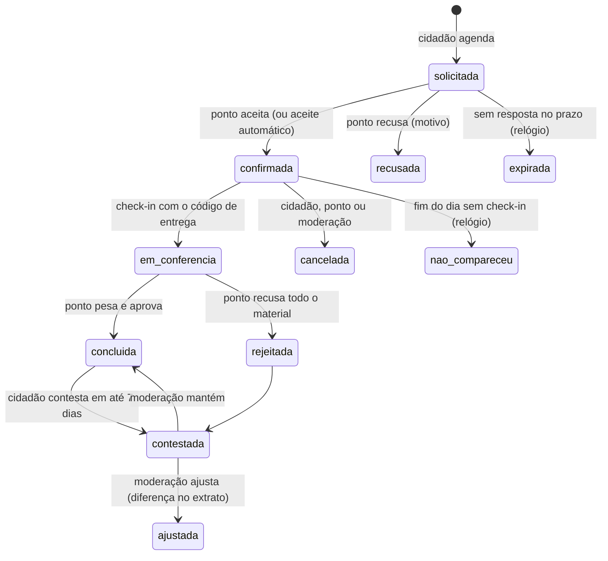
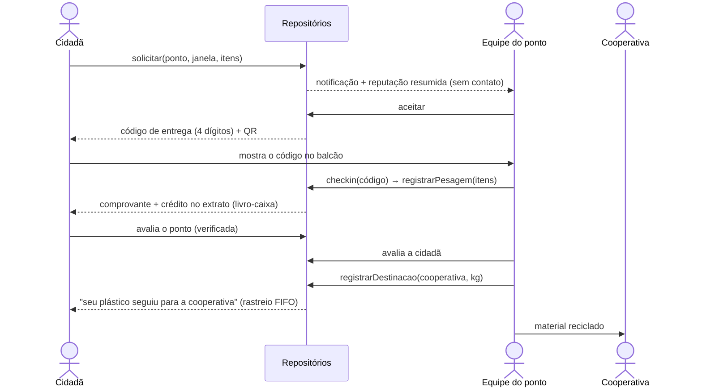
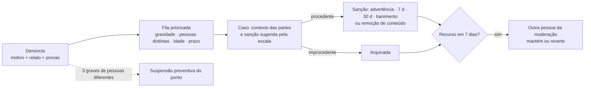

# Arquitetura do ECOLINK

Este documento explica **como o app é organizado** e **por quê**. As decisões estão registradas, uma por arquivo, em [`docs/adr/`](./adr/).

## Visão geral em camadas

```mermaid
flowchart TB
  subgraph Telas["Telas (React) — src/features, src/components"]
    C[Cidadão]
    P[Parceiro]
    A[Plataforma]
  end
  subgraph Repos["Repositórios assíncronos — src/data/repos (a “API”)"]
    R1[auth · coletas · parceiro · chat · estoque · equipe]
    R2[avaliacoes · reputacao · denuncias · moderacao · privacidade]
  end
  subgraph Dominio["Regras puras — src/domain (testadas sem navegador)"]
    D1[permissoes · coletaMaquina · agenda]
    D2[reputacao · denuncias · estoque · chat · extrato]
  end
  Banco[(modo local: localStorage<br/>transação atômica + migrações)]
  Supa[(modo supabase: Postgres<br/>RLS + funções security definer)]

  C & P & A -->|Promise + ErroApi com status HTTP| Repos
  Repos -->|pode&#40;ator, ação, recurso&#41;| Dominio
  Repos -->|VITE_FONTE_DADOS=local| Banco
  Repos -->|VITE_FONTE_DADOS=supabase<br/>supabase-js + JWT| Supa
```

Os **dois modos usam as mesmas telas e o mesmo domínio**. No modo Supabase, as regras que protegem os dados (permissões, transições da coleta, créditos de EcoPontos) rodam **no banco**, porque a chave pública fica no navegador ([ADR 0008](./adr/0008-supabase-com-seguranca-no-banco.md), [guia](./supabase.md)).

- **As telas nunca tocam no "banco".** Só chamam repositórios, que devolvem `Promise`s, simulam latência/falha de rede e lançam erros com status HTTP (401, 403, 404, 409, 422, 429…). Trocar o armazenamento local pelo Supabase é reimplementar `src/data/repos/` (ver [ADR 0001](./adr/0001-dados-no-dispositivo-com-repositorios.md) e o §17 do roadmap).
- **Quem é o usuário vem da sessão**, nunca de um id enviado pela tela (`chamarAutenticado` → `ator`), como o `auth.uid()` do Supabase.
- **Toda regra está no domínio** (funções puras) e é aplicada **no repositório**. A tela só esconde botões — segurança é no repositório ([ADR 0002](./adr/0002-regras-na-camada-de-dados.md)).

## A coleta: máquina de estados

Cada transição diz **quem** pode fazê-la (`domain/coletaMaquina.js`). A mais importante: **só o ponto conclui** — o cidadão nunca gera os próprios EcoPontos ([ADR 0003](./adr/0003-maquina-de-estados-e-quem-conclui.md)).

## Uma entrega, do agendamento ao destino final

## Moderação

## Segurança, em uma tabela

| Ameaça (STRIDE)                        | Mitigação no código                                                                                   |
| -------------------------------------- | ----------------------------------------------------------------------------------------------------- |
| **S**poofing — se passar por outro     | senha PBKDF2 (600 mil iterações), token de sessão guardado só como hash, código de entrega            |
| **T**ampering — alterar dados          | regras e permissões no repositório; transação atômica; extrato só de inclusão                         |
| **R**epudiation — negar que fez        | auditoria de cada ação sensível, inclusive tentativas negadas (403)                                   |
| **I**nformation disclosure — vazamento | minimização (o ponto vê "Ana R."), documentos privados, denunciante anônimo, export LGPD sem segredos |
| **D**enial of service — abuso          | bloqueio progressivo de login, limites de denúncia/mensagens/entregas em aberto                       |
| **E**levation of privilege             | `pode(ator, ação, recurso)` em todo repositório; conflito de interesse bloqueado                      |

## Qualidade

| Camada                          | Como é verificada                                                                |
| ------------------------------- | -------------------------------------------------------------------------------- |
| Regras (`src/domain`)           | Vitest, casos de borda; testes de mutação nas regras críticas                    |
| Repositórios (`src/data/repos`) | Vitest com "banco" em memória e relógio fixo, um arquivo por fase                |
| Jornada no navegador            | Playwright (`e2e/`): jornada completa, axe (WCAG 2.1 AA), teclado, LGPD, celular |
| Banco Supabase (`supabase/`)    | pgTAP: entra como cada pessoa e tenta o que não pode (RLS, privilégios, funções) |
| Jornada no Supabase             | Playwright contra o Supabase local (`e2e/supabase/`)                             |
| CI (GitHub Actions)             | lint → formatação → testes → build → E2E → banco → jornada no Supabase           |
